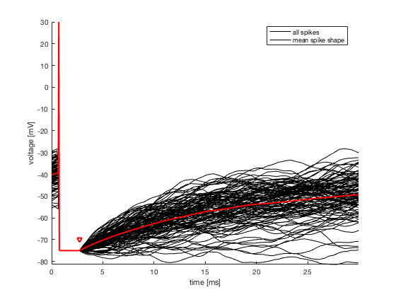
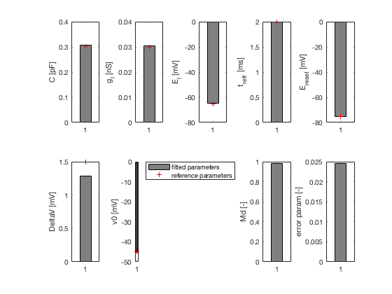
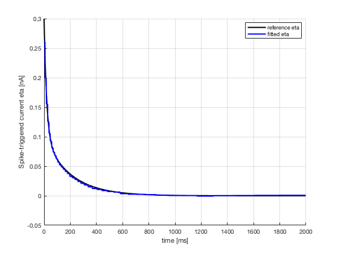
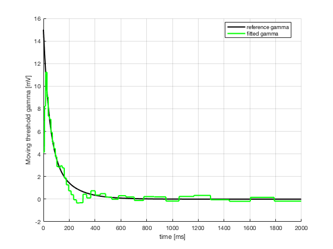
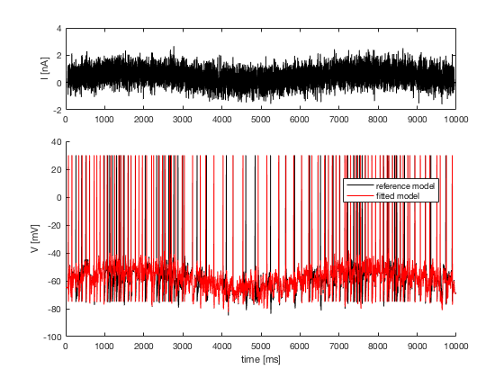
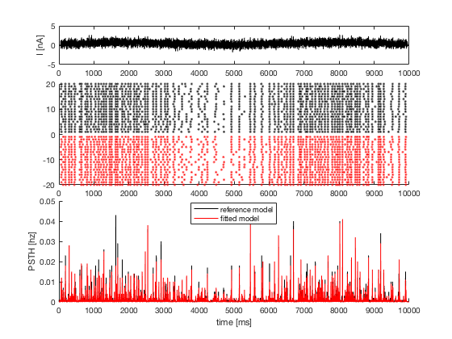

# Read me text to use the Integrate-and-fire fitting toolbox

The fitting procedure implemented here is described in detail in the following paper:

**Extraction and Classification of Three Cortical Neuron Types Reveals Two Distinct Adaptation Mechanisms**  
Skander Mensi, Richard Naud, Christian Pozzorini, Michael Avermann, Carl C.H. Petersen, and Wulfram Gerstner  
*Journal of NeuroPhysiology*, 2011

## Utilization

Simply run the script `fit_IF()` on the Matlab prompt:

```
fit_IF()
```

This script fits a stochastic IF model with spike-triggered current eta and moving threshold gamma as described by Eq 1-3, using voltage traces V and the injected current I. Here the fitting procedure is applied on surrogate data generated with the same model used for fitting. This is done to highlight the performance of our fitting method by evaluating the error done on the estimation of the reference parameters. The reference parameters somehow reflect parameters estimated on in-vitro recordings.

The model reference and the fitted model is described by Eq:

C(𝑉̇(𝑡)) = -g_l(V(t)-E_l) + I(t) + ∑_(t̂)(η(t-t̂))  
λ(t) = λ₀ exp(V(t) - ((V₀ + ∑_(t̂)γ(t-t̂))/Δ_V))

If spike:  
&emsp;V ← E_reset  
&emsp;t = t + t_refr  
&emsp;t ← t̂

## The main steps of the fitting procedure are:

1. Extract Spike Shape, absolute refractory period T_refr and corresponding voltage reset E_reset from V  
2. Estimate optimal spike-triggered current eta(t) and passive parameters, C, G_l and E_l with linear regression  
3. Estimate moving threshold gamma(t) by maximizing log-likelihood of the observed spike train  
4. Estimate performance of the fitted model on new data set (test set)  
5. Plot results  

## This script produces 5 figures:

1. Spike Shape with T_refr and E_reset  
  
2. Passive parameters  
  
3. eta(t)  
  
4. gamma(t)  
  
5. Predicted voltage traces and data voltage traces  
  
6. Raster plot and PSTH  
  

## Modifications for intracellular recordings

The script can be easily modified to estimate parameters from intracellular recordings. In this case, the user has to replace I and V by the injected current (in nA) and the recorded voltage (in mV). Then the user has to check the following parameters to ensure that the fitting goes properly:

1. Be sure that the spikes are well detected (here spike times are set to the maximum value (in a 1ms window), following upward zero-crossing).  
2. Double check the estimated t_refr and E_reset (i.e. in this simple implementation of the fitting procedure, t_refr is set to the time after the spike onset, where the minimal value of the spike shape is reached and E_reset is set to the value of this minima. However, depending on the cell type, the spike shape does not necessarily exhibit a local minimum following a spike; in this case, the user has to set t_refr to a reasonable value and then E_reset to the value of the mean voltage at this time.)  
3. Choose an appropriate value to set the onset of the spikes (as mentioned in 1., the spike times are set to the maximum value of the spikes, however to evaluate the threshold one has to consider the time at which the threshold is crossed with visual heuristics. It is possible to use figure 1 to choose the exact value of delay).  
4. The parameter delay is used two times with different values, once for the extraction of eta and once for the estimation of gamma; be sure to use an appropriate value for each step. Note: for eta the exact value of delay is not critical as soon as it removes completely the spike shape (for instance 2 or 3 ms before the maximum value of the spike), whereas the value of delay is highly critical to estimate gamma, since it sets the voltage at which a spike is emitted.

## WARNING

The fitting procedure is fast but requires high memory during the linear regression (matrix inversion). The longest part of the script is the performance evaluation, because one has to generate 1000 spike trains from the reference model and 1000 spike trains from the fitted model to evaluate Md. If too long, one can reduce the duration of the stimuli for the test set (30 seconds) or the number of repetitions (1000) used to compute the PSTH. On a MacBook Pro 2.3 GHz with 4 GB RAM, execution time is: 3 minutes.

## CONTACT

For any question or remark on the code contact:  
skander.mensi@epfl.ch

Copyright Skander Mensi 2011

---

2025-06-20: Converted README to Markdown.